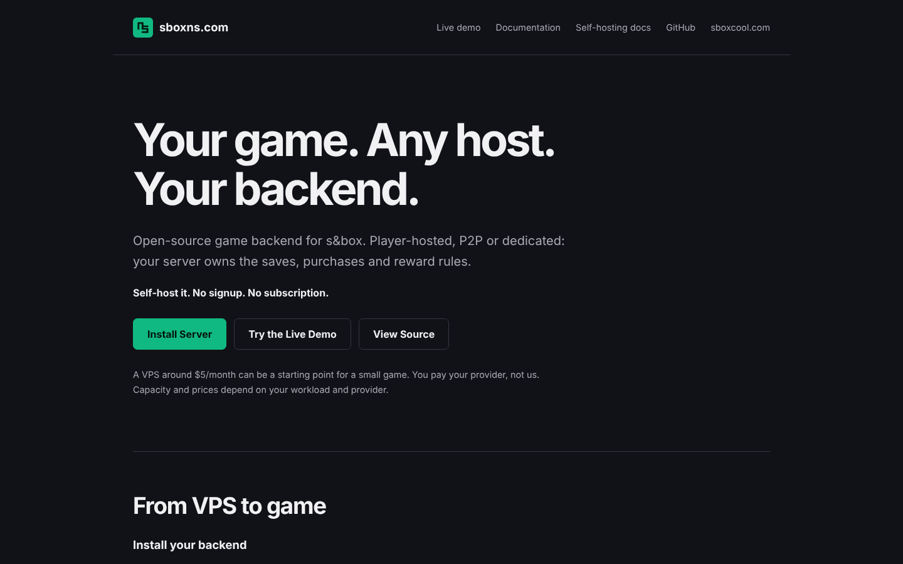
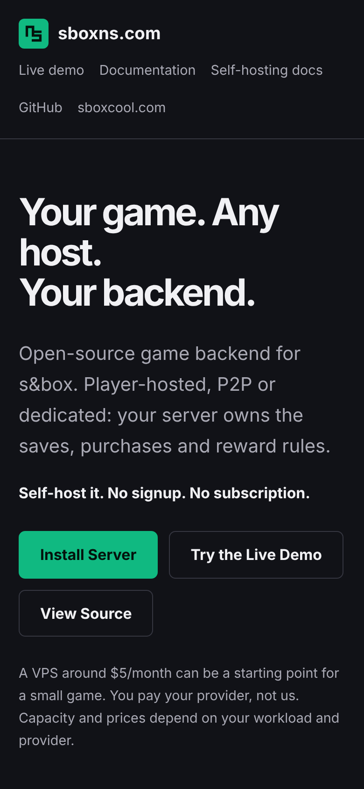
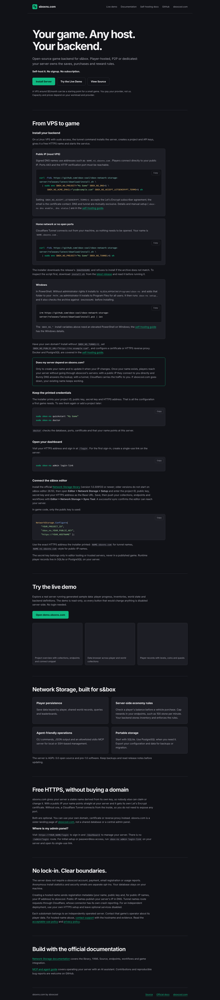
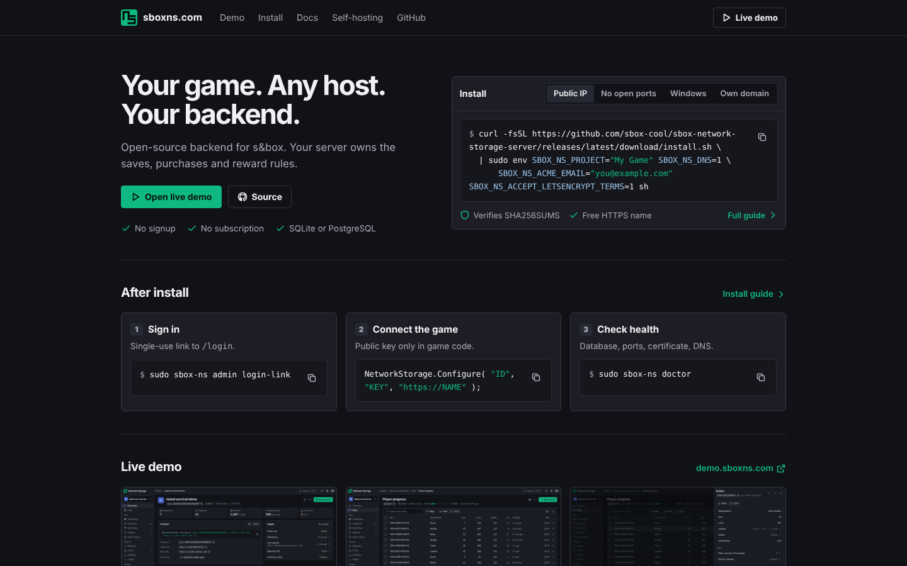
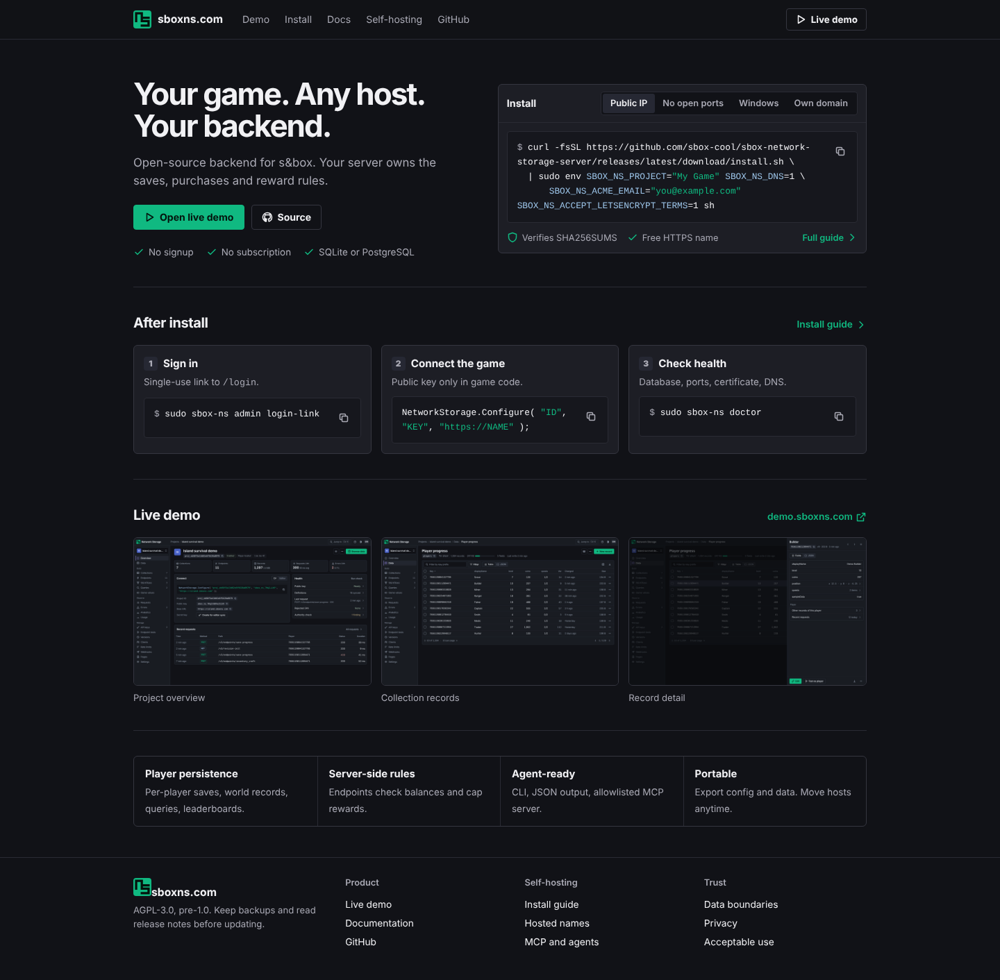
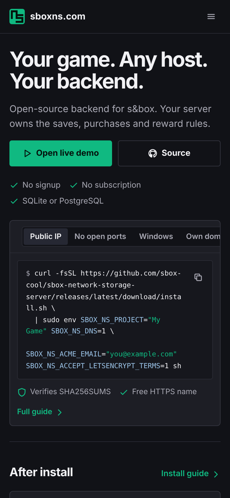
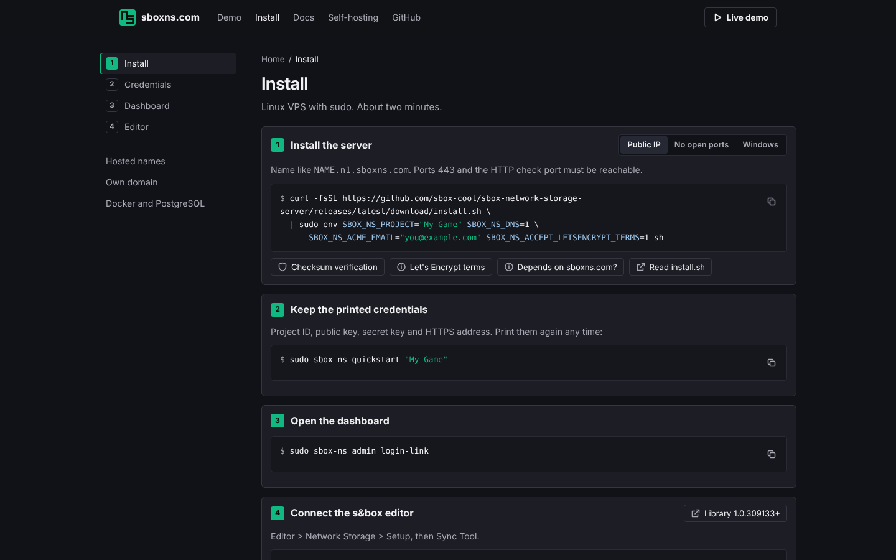
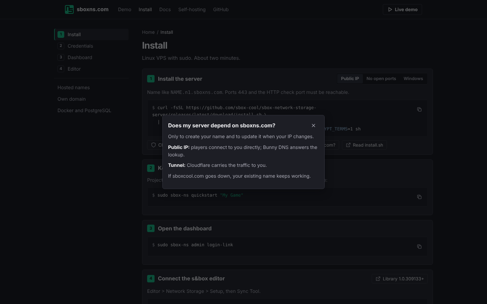
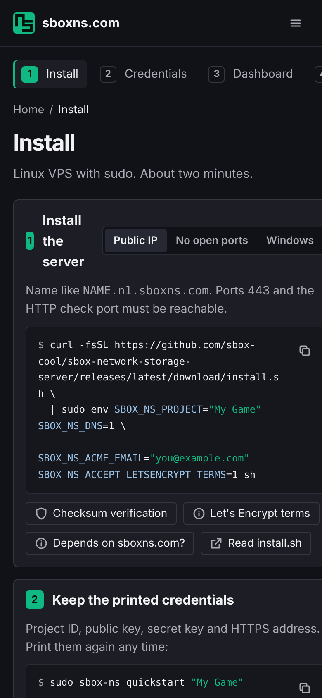

## Problem

The landing page is one long article. It is 6,542px tall at 1440x900 and about 9,700px on a 390px phone, with 1,115 words in `<main>`. The first viewport has a headline and three buttons; the install command, the reason most visitors come, starts below the fold. Policy and dependency explanations (Let's Encrypt terms, "Does my server depend on sboxns.com?", lock-in, privacy, abuse contact) sit inline between the commands.

| Desktop today | Mobile today | Full page today (scaled) |
| --- | --- | --- |
|  |  |  |

## Proposal

Same tokens and static HTML. The home page does three jobs, in this order: install, show what happens next, show the demo. Detail moves to pages and modals.

### Home

- Hero beside an install card. Tabs: Public IP, No open ports (tunnel), Windows, Own domain. One command each with a copy button. Two trust facts (checksum verified, free HTTPS name) and a Full guide link.
- After install: three cards, each a single command to copy (`admin login-link`, the `Configure` line, `doctor`).
- Live demo: three screenshots linking to demo.sboxns.com. (Thumbnails here are the proposed owner console screens from the server repo proposal.)
- Four features in one row, one sentence each.
- Footer groups the links that replace today's inline prose: Install guide, Hosted names, MCP and agents, Data boundaries, Privacy, Acceptable use.

| Full page | Mobile |
| --- | --- |
|  |  |

### Install guide (`/install/`)

Four steps with a sticky step list. Each step is one line plus a command. Explanations become chips that open a modal, or link out.

| Install page | Explanation modal | Mobile |
| --- | --- | --- |
|  |  |  |

### Where today's content goes

| Today (`index.html`) | Proposed |
| --- | --- |
| From VPS to game, four long steps | Home install card plus `/install/` |
| Public IP vs tunnel vs Windows vs own domain prose | Tabs on the install card and step 1 |
| SHA256SUMS paragraph, Let's Encrypt terms | Chips on step 1, modal |
| Does my server depend on sboxns.com? | Chip on step 1, modal; repeated on `/names/` |
| Free HTTPS, hosted name capacity, where is my admin panel | `/names/` |
| No lock-in, clear boundaries, abuse contact | `/trust/` |
| Built with the official documentation | Footer links |

### Implementation notes

- Stays a static site: plain HTML and `site.css`, no framework, no new external requests. `code.js` already adds copy buttons and highlighting; it keeps doing that.
- Tabs work without JavaScript: radio inputs and CSS, or every method's command stacked when JavaScript is off.
- New pages (`/install/`, `/names/`, `/trust/`) each get their own title, description and canonical URL, and are added to `sitemap.xml` and `llms.txt`. The home page keeps the JSON-LD.
- `capacity.js` moves to `/names/` with the capacity tiles.
- The demo screenshots should be refreshed once the owner console redesign ships.

## Alternatives considered

- **Collapse the long sections with `
` on one page.** Keeps one URL, but search engines and readers still get one long page, and the install command still competes with policy text.
- **Single-page app with routed views.** Adds a build step and JavaScript dependency to a page that is static today.

Mockups: `proposals/ui-redesign/mockup/` on this branch (open `home.html` or `install.html`). This folder is proposal material only and must not be merged into `main`, since GitHub Pages would publish it.
